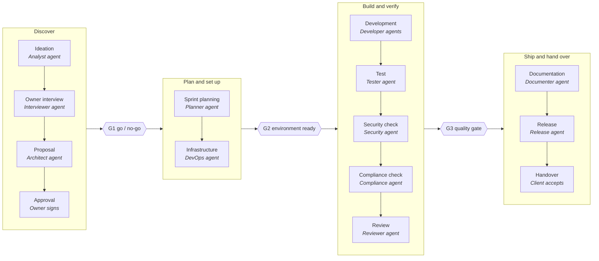
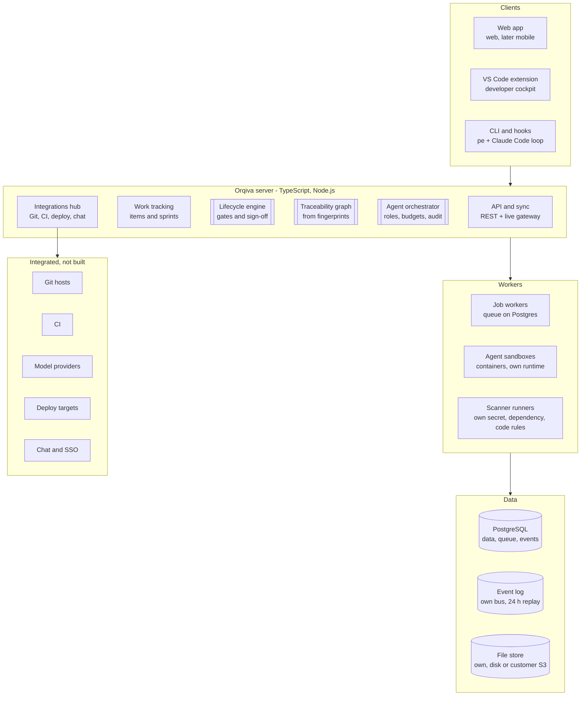
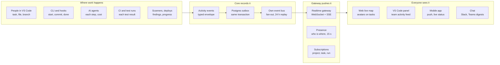
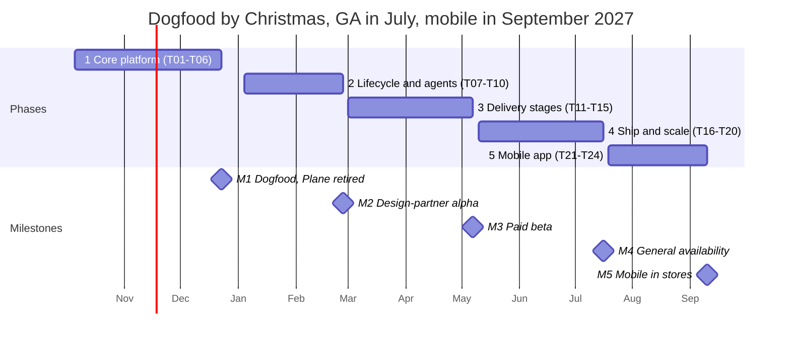

<!-- [PCODE-192 | S15 | v0.1.0] Rebrand ProdEngine and PlaneCode to Orqiva everywhere, with compatibility for existing installs -->
<!-- ── [PCODE-81 | S08 | v0.1.0] Commit the Orqiva 2027 strategy, development plan and sprint plan to the repository ── -->

# Orqiva 2027 — Product Strategy, Development Plan & Sprint Plan

As of 2 Oct 2026. Drafted with the owner in Claude Docs
([original](https://claude.ai/code/artifact/4719ce73-5a58-4dc8-8aee-86cd8ea76072)); **this file is now the
source of truth** — change the plan here, through a Plane task, and keep `.orqiva/roadmap.md` in step.

<!-- [PCODE-152 | S15 | v0.1.0] Replan: feature specification and design-first roadmap for the command center -->

> **Update 4 Oct 2026: design first.** After T15 the owner decided that the whole platform is designed
> and approved as a clickable preview before more backend work (phase D, gate A1). The sections, the
> features of each and the new order are in [command-center-spec.md](command-center-spec.md); the
> sprint table below still holds for T16–T24, which move behind the rebuild.

## Executive summary

Orqiva becomes a self-hostable engineering command center: one platform that carries every product from idea to handover through gated stages, staffed by humans and AI agents working side by side. We stop building on Plane and build our own core, 100% our own code on Node.js and PostgreSQL, keeping what v0.1.0 proved works: no code without a task, fingerprints, generated docs, release and deploy.

**The gap we sell into.** Teams of 5–60 engineers stitch 8–12 tools together: Jira or Linear for tickets, Notion for proposals, TestRail for tests, Snyk for security, Vanta for compliance, GitHub for code, a coding agent in the IDE. None of them knows what the others know, and none of them treats an AI agent as an accountable team member. Orqiva owns the thread between them.

**What we build.**

1. A lifecycle engine: 14 stages from ideation to release, each with entry and exit gates, evidence and sign-off.
2. A traceability graph: requirement → task → commit → test → security finding → release, generated from fingerprints rather than typed by hand.
3. An agent workforce: role-based AI agents (interviewer, analyst, architect, developer, tester, security, compliance, documenter, release manager) with permissions, budgets and human approval gates.
4. A live portfolio command center: every project, person, agent, test run and gate across the company on one screen, updating in real time in the browser, in VS Code and later on mobile.
5. One-command installation: Docker Compose or Helm on the customer's own server, or our cloud.

**Who buys it.** Software teams of 5–60 people, startups, and product engineering agencies that run several client projects at once. We sell yearly subscriptions per human seat, with AI agents included when the customer brings their own model key.

**Timeline.** 24 two-week sprints from 5 Oct 2026. Orqiva replaces Plane for its own development by 23 Dec 2026, reaches design-partner alpha on 26 Feb 2027, paid beta on 7 May 2027, general availability on 16 Jul 2027 and the mobile app stores on 10 Sep 2027.

## Where Orqiva stands today (v0.1.0)

v0.1.0 is a working single-developer governance layer on top of Plane: a VS Code extension (about 17,000 lines of TypeScript, 419 unit and 16 end-to-end tests) driving a Python engine that alone writes to Plane. It was built in 14 one-day sprints and 80 tasks between 22 Sep and 2 Oct 2026.

| Area         | What works now                                                                           | Limit for the new product                                                     |
| ------------ | ---------------------------------------------------------------------------------------- | ----------------------------------------------------------------------------- |
| Task loop    | sync, start, done; no code without a task, enforced by Claude Code hooks                 | One developer per machine; the active task is a local file                    |
| Traceability | Fingerprints `[TASK \| SPRINT \| VERSION]` in every code block; index and generated docs | Stops at code; no link to requirements, tests or findings                     |
| Planning     | Description → architecture, rules, design system, one-day sprints; New project wizard    | No ideation, owner interview, proposal or approval stage                      |
| Release      | Version bump, changelog, tags, Docker files, deploy over Coolify or SSH, health check    | No release train, environments or rollback across projects                    |
| Security     | Checklist, npm audit, pip-audit, secret scan                                             | Manual ticking; no SAST, container or licence scanning; no compliance mapping |
| Portfolio    | Dashboard across the Plane workspace                                                     | 3 requests per project, 20 requests/min ceiling on Plane's API                |
| Installation | Windows installer bundle with VS Code, Claude Code and prerequisites                     | Windows only; macOS never run; the server side is someone else's Plane        |
| Data         | Plane is the source of truth; extension is read-only                                     | We cannot model gates, agents, evidence or licensing in Plane's schema        |

**What carries over.** The rules (no code without a task, state follows work, fingerprints, done means committed and posted), the fingerprint parser and scanner, docs generation, the release and deploy adapters, the security runners, the installer know-how, and the VS Code extension as the developer's cockpit. **What goes.** Plane as the store, the Python engine as the only writer, and the 20 requests/min polling model.

## Market review: current tools and their gaps

Every tool on the market covers two or three of our 14 stages well; none carries a product from idea to handover, and none treats AI agents as governed team members across stages. A typical 20-person team pays for 6–9 of these tools and still keeps the thread between them in people's heads.

| Tool                                                                                        | Stages it covers well                | Price (annual, per user/month)                      | What it lacks for our buyer                                                                                                                   |
| ------------------------------------------------------------------------------------------- | ------------------------------------ | --------------------------------------------------- | --------------------------------------------------------------------------------------------------------------------------------------------- |
| [Jira](https://automationatlas.io/answers/jira-pricing-explained-2026/) + Confluence + Rovo | Tracking, sprints, docs              | $7.91 Standard, $14.54 Premium; Rovo credits pooled | Heavy to configure; lifecycle stages are custom workflows; AI is a search-and-chat layer; tests, security, compliance are marketplace add-ons |
| [Linear](https://linear.app/pricing)                                                        | Tracking, cycles, triage             | $10 Basic, $16 Business                             | Fast and loved, but stops at the ticket; no proposals, gates, tests or compliance; cloud only                                                 |
| [Plane](https://plane.so/pricing)                                                           | Tracking, cycles, pages; self-hosted | $6 Pro, $13 Business                                | The base of v0.1.0; AI credits only in its cloud; no lifecycle, agents or evidence; API rate limit shaped our design                          |
| [GitHub](https://github.com/pricing) (Issues, Projects, Actions, Copilot)                   | Code, review, CI, coding agent       | $4 Team, $21 Enterprise; Copilot extra              | Code-centric; nothing before the first issue or after the merge; portfolio view is thin                                                       |
| GitLab / Azure DevOps                                                                       | Code to deploy in one suite          | approximate: $29 Premium (GitLab)                   | Strong DevSecOps, weak discovery and proposals; heavy for teams under 50                                                                      |
| Productboard, Aha!, Notion                                                                  | Ideation, roadmaps, proposals        | approximate: $20–60 per maker                       | Disconnected from delivery; no link from a promise to the code that kept it                                                                   |
| [TestRail](https://www.testrail.com/pricing/), Xray, Qase                                   | Test cases, runs                     | €22 Essentials, €38 Professional                    | A separate island; traceability to requirements is typed by hand                                                                              |
| Snyk, Semgrep, SonarQube                                                                    | SAST, dependencies, containers       | approximate: $25+ per developer                     | Findings live outside the plan; nobody owns closing them per release                                                                          |
| Vanta, Drata                                                                                | SOC 2, ISO 27001 evidence            | approximate: $10k+ per year                         | Built for company controls, not per-release product evidence                                                                                  |
| Claude Code, Cursor, Devin, Copilot agent                                                   | Writing code                         | Per seat or usage                                   | Excellent at a task, blind to the plan, the gate and the portfolio; no accountability trail                                                   |

**The five gaps Orqiva is built to close.**

1. **No front half.** Owner interviews, proposals and approvals happen in documents and email, then get retyped as tickets.
2. **No thread.** No tool links a requirement to its code, its tests, its security findings and the release that shipped it without manual linking.
3. **Agents without governance.** Coding agents act per task with no role, budget, permission model or audit trail across a team.
4. **No portfolio for agencies.** Product engineering companies run 5–30 client projects; every tool is organised around one team or one repo.
5. **Cloud lock-in.** The AI features of Plane, Linear and Jira run only in the vendor's cloud. EU teams and agencies with client NDAs want the whole stack on their own server with their own model key.

Prices fetched 2 Oct 2026; rows marked approximate are from memory and need checking before any sales material.

## Build decisions: develop, integrate, skip

We build the parts no tool connects (lifecycle, traceability, agents, portfolio) and our own work-tracking core, because those must share one data model. We integrate where mature tools already win, and we skip what would turn us into a Git host, a CI farm or an editor.

| Capability                                                 | Decision                                                                                                                                                                                 | Why                                                                                           |
| ---------------------------------------------------------- | ---------------------------------------------------------------------------------------------------------------------------------------------------------------------------------------- | --------------------------------------------------------------------------------------------- |
| Work tracking (items, sprints, boards, states)             | **Build**                                                                                                                                                                                | Plane's schema cannot hold gates, agents or evidence; its 20 requests/min API capped v0.1.0   |
| Lifecycle engine with stages, gates, sign-off              | **Build**                                                                                                                                                                                | The core differentiator; nobody ships it                                                      |
| Ideation, owner interview, proposal, approval              | **Build**                                                                                                                                                                                | The missing front half; an AI interviewer drafts the proposal from the conversation           |
| Traceability graph from fingerprints                       | **Build**                                                                                                                                                                                | Our existing edge, extended to requirements, tests, findings and releases                     |
| Agent orchestration (roles, budgets, approvals, audit)     | **Build**                                                                                                                                                                                | The second differentiator; our own agent runtime calling model APIs directly; model-pluggable |
| Live activity layer (events, presence, streaming runs)     | **Build**                                                                                                                                                                                | What makes the command center feel alive; see its section below                               |
| Test management (cases, runs, coverage to requirements)    | **Build, lean**                                                                                                                                                                          | Replaces TestRail for our buyer; imports JUnit results from any CI                            |
| Release and version management                             | **Build**                                                                                                                                                                                | Carried over from v0.1.0 and extended to release trains                                       |
| Portfolio command center                                   | **Build**                                                                                                                                                                                | The agency and multi-team buyer's main reason to switch                                       |
| Compliance evidence packs (ISO 27001, SOC 2, GDPR, EU CRA) | **Build mapping, not audits**                                                                                                                                                            | Evidence comes free from the graph; we map it to controls                                     |
| Code documentation and handover packs                      | **Build**                                                                                                                                                                                | Carried over from v0.1.0                                                                      |
| Git hosting, pull requests                                 | **Integrate**: GitHub, GitLab, Gitea, Bitbucket                                                                                                                                          | Teams will not move their code                                                                |
| CI pipelines                                               | **Integrate**: Actions, GitLab CI; plus a small runner for agent jobs                                                                                                                    | A CI product is a different company                                                           |
| Security scanning                                          | **Build**: own secret scanner, dependency audit on public advisory data, code rules for JS/TS and Python; container scanning after GA; SARIF import for scanners a customer already runs | No third-party code or licence terms; we own the rules, the triage and the gate               |
| Infrastructure                                             | **Integrate** with the customer's own tools, never shipped: Docker, Coolify, SSH, Kubernetes, OpenTofu/Terraform                                                                         | v0.1.0 adapters extend naturally                                                              |
| Chat, SSO, identity                                        | **Integrate**: Slack, Teams, OIDC, SAML, SCIM                                                                                                                                            | Table stakes                                                                                  |
| Migration in                                               | **Build importers**: Plane, Jira, Linear, GitHub Issues                                                                                                                                  | Switching cost is the first objection                                                         |
| Own code editor or VS Code fork                            | **Skip**                                                                                                                                                                                 | The extension proved a cockpit inside VS Code is enough; JetBrains plugin later               |
| Own language model                                         | **Skip**                                                                                                                                                                                 | Bring your own key (Claude by default), or our managed credits                                |

**Differentiators we defend in every release.** Lifecycle gates with evidence; the automatic thread from requirement to release; agents that are accountable team members; one live command center across projects; full self-hosting including the AI features.

## Product scope: the lifecycle and the agent workforce

A project in Orqiva is a walk through 14 stages in four phases; a gate between phases blocks progress until its evidence is complete and a named human signs. Each stage has a default agent that drafts the work and a human role that owns the decision.

- **G1 Go / no-go:** owner approves proposal, budget and plan.
- **G2 Environment ready:** infrastructure provisioned and verified.
- **G3 Quality gate:** tests, security, compliance and review all pass before release.
- Across every stage: project management, the traceability graph and the portfolio command center.

Stages inside a phase run in order but can overlap; Development, Test and Security loop every sprint until G3 passes. Every agent action lands on an item with its prompt, diff, cost and approver, so the audit trail is the work itself.

**Agent rules.** Agents act only inside a sandbox, within a token budget per run and per month, with the permissions of their role. Anything that merges, deploys, approves or contacts a client waits for a human. Teams can add custom agents with their own prompts, tools (through MCP) and gates.

## Architecture, stack and installation

Orqiva is one TypeScript server with one PostgreSQL database, shipped as container images that install with a single command; agents and scanners run in isolated worker containers beside it. The command center reads every project in a workspace from that one database, so a portfolio view is a query, not 31 API calls.

Clients talk only to the API; agents talk to the same API through the Orqiva MCP server, so an agent can do nothing a user with its role could not. One install: Docker Compose or Helm on your server, or the same images in our cloud. Double-bordered boxes are the three parts no other tool ships.

| Layer     | Choice                                                                                                                                                                                                                     | Why                                                                                                                      |
| --------- | -------------------------------------------------------------------------------------------------------------------------------------------------------------------------------------------------------------------------- | ------------------------------------------------------------------------------------------------------------------------ |
| Language  | TypeScript end to end, one monorepo (npm workspaces, own build scripts); compilers and test tools are development-only and never ship                                                                                      | Reuses v0.1.0 code; one language for server, web, CLI and extension                                                      |
| Server    | Node.js 22 built-ins only: our own HTTP router, validation, OpenAPI generator and SQL layer                                                                                                                                | No third-party code in the backend: the v0.1.0 rule of zero runtime dependencies, continued                              |
| Database  | PostgreSQL 17 with row-level security per workspace, reached through the `pg` driver; built-in full-text search; no extensions                                                                                             | Platform: permissive PostgreSQL Licence and MIT driver. One store for work, graph, search, events, jobs and agent memory |
| Real-time | Our own local-first sync protocol for data, our own event bus and WebSocket gateway for live activity (next section)                                                                                                       | Linear-grade speed is the first impression                                                                               |
| Jobs      | Our own job queue on Postgres (`FOR UPDATE SKIP LOCKED`)                                                                                                                                                                   | No extra broker to install                                                                                               |
| Web app   | React 19 bundled by our own esbuild script (development only), TanStack Router and Query, Tailwind, the v0.1.0 design system; React Native (Expo) for mobile, sharing types and protocol code; MIT-licensed libraries only | Mainstream, hireable, fast                                                                                               |
| Agents    | Our own agent runtime in per-run containers, calling model provider APIs over HTTPS with the customer's key; our own MCP server written from the open protocol spec                                                        | No SDK dependency; Claude by default, any provider behind one interface                                                  |
| Scanners  | Our own: secret scanner (from v0.1.0), dependency audit against OSV, GitHub Advisory and NVD data, code rules for JS/TS and Python; container scanning after GA                                                            | Advisory data is open data (CC-BY 4.0 or public domain), used with attribution                                           |
| Install   | Docker Compose (Team), Helm chart (Business, Enterprise), installer CLI `orq install` with health checks                                                                                                                   | One command to a running system                                                                                          |
| Identity  | Email, OIDC, SAML and SCIM (Enterprise)                                                                                                                                                                                    | Fits company identity providers                                                                                          |
| Licensing | Our own signed offline licence keys (Node crypto); Stripe's API called directly, no SDK                                                                                                                                    | Works air-gapped                                                                                                         |

## Live activity layer: who is doing what, right now

Every screen of Orqiva, in VS Code, in the browser and later on a phone, shows work as it happens: who is on which task, how far along it is, which test is running and which agent is at which step. Like a ride on a map, a task is something you watch move, not a status you refresh.

Target: event to screen under 1 s at p95; a reconnecting client replays what it missed. Every change is saved with its activity event in one database transaction, so the live view can never show something that did not happen.

**Protocols.**

| Layer        | Choice                                                                                                                              | Why                                                                                                             |
| ------------ | ----------------------------------------------------------------------------------------------------------------------------------- | --------------------------------------------------------------------------------------------------------------- |
| Event format | Typed activity events in our own envelope, field-compatible with the CloudEvents 1.0 spec: actor, verb, object, progress, timestamp | One schema for people, agents, CI and scanners; readable by other tools                                         |
| Capture      | Transactional outbox in PostgreSQL                                                                                                  | No lost or phantom events                                                                                       |
| Bus          | Our own bus: Postgres outbox, `LISTEN/NOTIFY` wake-up, gateway nodes fan out from memory, 24 h replay from the event table          | Nothing extra to install or license; thousands of clients per server, more gateway nodes behind a load balancer |
| To clients   | Our own WebSocket server (RFC 6455) and Server-Sent Events fallback, on Node built-ins, with a typed protocol                       | Two-way for presence and live cursors; SSE survives corporate proxies                                           |
| Data sync    | Our own local-first sync protocol for items and boards                                                                              | Lists stay correct offline and merge on reconnect                                                               |
| Presence     | Heartbeat every 15 s: user or agent, project, task, file, state                                                                     | Shows who is where without polling                                                                              |
| Mobile       | Push through APNs and FCM; iOS Live Activities and Android ongoing notifications for test runs, deploys and agent runs              | Progress on the lock screen, like a ride arriving                                                               |
| VS Code      | The extension subscribes over the same WebSocket                                                                                    | No more 30-second polling or the 20 requests/min ceiling                                                        |

**What the screens show.**

- **Live map:** projects as lanes, tasks as cards, each person and agent as an avatar on the card they are working; cards fill as they progress.
- **Progress that is measured, not guessed:** acceptance criteria ticked, subtasks done, tests passed out of total, agent plan steps finished, time spent against estimate.
- **Live runs:** a test run streams each result as it lands; a deploy shows each step; an agent run shows each tool call and its cost.
- **Replay:** a time slider replays the last 24 hours of a project, for stand-ups and incident reviews.
- **Alerts:** a gate blocked, a test failing, an agent over budget or waiting for approval reaches the right person within seconds.

**Respecting people.** Activity is shown at task level, never keystrokes or screen time. Each workspace sets what presence shows. German and EU customers will need this for works council approval.

## Ownership and licence policy

<!-- [PCODE-82 | S08 | v0.1.0] Record the plan decisions and load team sprints T01-T06 into Plane -->

Orqiva is 100% our own code on a small platform, and nothing we ship may carry licence terms that stop us selling it, keep its source closed or charge for it (decided 2 Oct 2026). Plane, and every other third-party product, is gone from the backend by M1.

**The platform: the only third-party software the backend runs on.**

| Component                              | Licence                          | Why it is safe to sell on                                                                                                                                         |
| -------------------------------------- | -------------------------------- | ----------------------------------------------------------------------------------------------------------------------------------------------------------------- |
| Node.js 22                             | MIT                              | Permissive; we run it, we do not modify it                                                                                                                        |
| PostgreSQL 17                          | PostgreSQL Licence               | Permissive, BSD-style; no extensions used                                                                                                                         |
| `pg` (node-postgres) driver            | MIT                              | Permissive; the one npm package in the backend                                                                                                                    |
| Docker Engine and the customer's Linux | Apache-2.0 / various             | The customer's own installation; we never ship Docker Desktop                                                                                                     |
| Base image of our containers           | Debian slim (GPL and LGPL parts) | Running on GPL software does not make our code GPL; we publish the image's package list and point to Debian's sources, which is all the GPL asks of a distributor |

**Licences we accept in anything we ship** (frontend and mobile libraries, fonts, icons, data): MIT, BSD-2-Clause, BSD-3-Clause, Apache-2.0, ISC, 0BSD, Unlicense, CC0-1.0, the PostgreSQL Licence; SIL OFL-1.1 for fonts; CC-BY-4.0 for icons and data, with attribution.

**Licences we never ship:** GPL, LGPL, AGPL, SSPL, MPL inside our bundles, Business Source Licence (BSL/BUSL), Elastic Licence, Commons Clause, any non-commercial (NC) or "no SaaS" clause, and packages with no licence at all. AGPL matters most: MinIO, Plane and Grafana use it, and it would force our server's source open.

**How we enforce it.**

1. **From T01, CI fails** when a shipped dependency carries a licence outside the accepted list; our own licence checker reads every package's licence file, not just its manifest.
2. **Every release ships an SBOM** (CycloneDX format, generated by our own code) and a `THIRD-PARTY-NOTICES` file with every attribution.
3. **Development tools never ship.** TypeScript, the bundler and the test runners stay in the build; the release check proves none of their code is in the bundles.
4. **No copied code.** People and agents write code; nothing is pasted from repositories, answers or examples under another licence. A short snippet with a permissive licence goes in only with its notice.
5. **External services, not code:** model providers, Stripe, GitHub and GitLab are reached over their public APIs with the customer's or our own account; their SDKs are not used.
6. **Our own code is proprietary.** The repository's MIT `LICENSE` is replaced with a proprietary licence in T01, so no one can copy or resell Orqiva.
7. **AI-written code.** Our model provider's commercial terms give us the rights to its output; every block is reviewed by a person and carries a fingerprint, which records who and what wrote it. Some countries do not protect purely machine-written code by copyright, so human review and the fingerprint trail are part of how we own it.
8. **Legal review before GA:** a software licensing lawyer checks this policy, the SBOM and our customer licence in T19.

The customer's own tools that Orqiva connects to (Git hosts, Kubernetes, OpenTofu, Claude Code on a developer's machine) stay theirs; the installer downloads them from their makers and never bundles them.

## Commercial model

We sell yearly subscriptions per human seat, self-hosted or in our cloud at the same price, with AI agents included when the customer brings their own model key. The anchor: Jira Premium, TestRail Professional and a security scanner together cost a team roughly $75–80 per user per month; Orqiva Business replaces all three for €35.

| Plan              | Price (per seat/month, billed yearly) | For                          | Includes                                                                                                                                          |
| ----------------- | ------------------------------------- | ---------------------------- | ------------------------------------------------------------------------------------------------------------------------------------------------- |
| Team              | €19 (€228/year)                       | 3–25 seats, one or two teams | All 14 stages, up to 5 projects, standard agents with your own key, GitHub/GitLab, Docker install                                                 |
| Business          | €35 (€420/year)                       | 10–150 seats, agencies       | Unlimited projects, portfolio command center, custom agents and gates, test management, compliance packs, SSO, audit log, free client guest seats |
| Enterprise        | from €55, quoted                      | 150+ seats, regulated        | Helm/air-gapped install, SAML and SCIM, data residency, support SLA, custom compliance frameworks                                                 |
| Managed AI add-on | usage, at model cost + 20%            | Teams without their own key  | Pooled credits, per-agent budgets, monthly report                                                                                                 |

**Packaging rules.** Minimum 3 seats. AI agents are not seats. Client stakeholders who only review and approve are free guests. A 14-day trial and a free single-user Community edition (self-hosted, one project) feed the funnel.

**Go to market.**

1. **Design partners (Feb–May 2027):** 5–8 teams from our own network, free for one year in exchange for weekly feedback and a case study.
2. **Startup programme:** 50% off the first year for companies under 2 years old and 15 seats.
3. **Agency partner programme:** product engineering companies resell to their clients and earn 20%; their delivery runs on Orqiva, so every client sees it.
4. **Developer-led entry:** the free Community edition and the VS Code extension on the Marketplace bring individual developers who then pull in their team.
5. **EU first:** self-hosting, GDPR and EU Cyber Resilience Act evidence packs are the opening pitch to German and EU teams; US cloud follows.

**First-year target (open to the owner's revision):** 40 paying teams averaging 12 seats on Team or Business, about €150k annual recurring revenue by July 2028.

## Development roadmap

Five phases take Orqiva from today's extension to general availability on 16 Jul 2027 and onto phones by 10 Sep 2027; the first milestone is the hardest test, because from 23 Dec we build Orqiva only with Orqiva.

1. **Core platform (T01–T06):** our own work tracking, live from day one; the loop and fingerprints on our own server; the VS Code extension re-pointed; Plane imported and retired.
2. **Lifecycle and agents (T07–T10):** stages and gates, the agent runtime, ideation to approval, sprint planning; three design partners installed.
3. **Delivery stages (T11–T15):** infrastructure, test management, security, compliance and review; licensing and billing; first paying customer.
4. **Ship and scale (T16–T20):** docs and handover, release trains, the live portfolio command center, enterprise install, launch.
5. **Mobile app (T21–T24):** iOS and Android apps on the same live protocol: feed, live map, approvals, lock-screen progress for deploys, tests and agent runs; in the stores by 10 Sep 2027.

## Sprint plan

20 two-week sprints run from 5 Oct 2026 to GA on 16 Jul 2027, and 4 more bring the mobile app to the stores by 10 Sep 2027; each closes on a demo and a tagged build, and inside each one we keep the one-day sprints and the loop that built v0.1.0. Staffing (decided 2 Oct 2026): the owner with Claude Code agents through T06, a first engineer from January 2027 and a second by March 2027; if M1 slips by more than two weeks, the dates after it are re-planned.

<!-- [PCODE-82 | S08 | v0.1.0] Record the plan decisions and load team sprints T01-T06 into Plane -->

**Team sprints and daily sprints.** T01–T24 are two-week team sprints; in Plane each is a module, and its tasks wait in Backlog. `plane start` pulls a task into the one-day sprint (a Plane cycle, "Sprint NN") it is worked in, and the fingerprint carries that daily code (`S08`, `S09` …). The letters keep the two apart: a T code is a plan, an S code is the day the work happened.

| Sprint | Dates         | Goal                                  | Main deliverables                                                                                                                                                                                                                                     | Exit criteria                                                             |
| ------ | ------------- | ------------------------------------- | ----------------------------------------------------------------------------------------------------------------------------------------------------------------------------------------------------------------------------------------------------- | ------------------------------------------------------------------------- |
| T01    | 5–16 Oct 2026 | Foundations                           | Monorepo, CI, Postgres schema v1, auth (email + OIDC), API skeleton, web shell, design system port; **activity event schema and Postgres outbox**; **licence policy: proprietary LICENSE, own licence and SBOM check failing CI on a denied licence** | `docker compose up` gives a login page on a clean Ubuntu VM               |
| T02    | 19–30 Oct     | Work-tracking core, live from day one | Workspaces, projects, items, states, labels, comments, real-time sync; **own event bus, WebSocket gateway, SSE fallback**                                                                                                                             | An edit in one browser shows in another in under 1 s                      |
| T03    | 2–13 Nov      | Planning core and presence            | Sprints, backlog, board and list views, filters, command bar; **presence: who is on which task, avatars on cards**                                                                                                                                    | Two users see each other move between tasks live                          |
| T04    | 16–27 Nov     | The loop moves home                   | Engine rewritten as a TypeScript service and CLI `orq`; hooks, fingerprints, `done` posting commit and files; **every loop step emits an event**                                                                                                      | `orq start/commit/done` appears on the board live                         |
| T05    | 30 Nov–11 Dec | Cockpit and import                    | VS Code extension on the new API **over WebSocket, with a team activity feed**; Plane importer with history                                                                                                                                           | All PCODE items imported; polling removed from the extension              |
| T06    | 14–23 Dec     | **M1: Dogfood**                       | Git integration (GitHub, Gitea): commits and PRs on items, live; Plane retired for this project                                                                                                                                                       | Orqiva builds Orqiva for 5 working days with no Plane                     |
| T07    | 4–15 Jan 2027 | Lifecycle engine                      | Stage and gate model, templates, gate checklists, sign-off; gate changes pushed live                                                                                                                                                                  | A project walks Ideation → Approval with gates blocking correctly         |
| T08    | 18–29 Jan     | Agent runtime                         | Sandboxed agent runs on our own runtime, roles, permissions, budgets, audit log, MCP server; **agent runs stream each step and cost**                                                                                                                 | An agent's run is watchable step by step from the board                   |
| T09    | 1–12 Feb      | Front half                            | Ideas inbox, AI owner interview, proposal generator, estimate, approval workflow with e-sign                                                                                                                                                          | Interview → proposal → approval → plan in under one hour                  |
| T10    | 15–26 Feb     | **M2: Alpha**                         | Sprint planning agent, capacity, design-partner install kit, Jira and Linear importers; **measured progress on every card**                                                                                                                           | 3 design-partner teams installed and running a sprint                     |
| T11    | 1–12 Mar      | Infrastructure stage                  | Environments, OpenTofu and Docker templates, Coolify/SSH/Kubernetes deploy, secrets vault; **deploys stream each step**                                                                                                                               | An approved project gets a running staging environment from a gate        |
| T12    | 15–26 Mar     | Test management                       | Test cases from acceptance criteria, runs, JUnit import, coverage to requirements, tester agent; **test runs stream each result**                                                                                                                     | A running suite shows pass/fail per test as it happens                    |
| T13    | 29 Mar–9 Apr  | Security stage                        | Own secret scanner, dependency audit (OSV, GitHub Advisory, NVD data), code rules for JS/TS and Python, SARIF import; findings as items; security gate; security agent triage                                                                         | A release is blocked by an open high finding and unblocked by its fix     |
| T14    | 12–23 Apr     | Compliance and review                 | Control mapping (ISO 27001, SOC 2, GDPR, EU CRA), evidence packs, review stage, reviewer agent                                                                                                                                                        | One click exports an evidence pack for a release                          |
| T15    | 26 Apr–7 May  | **M3: Paid beta**                     | Traceability graph view, licence keys, Stripe billing, cloud tenant, hardening; **mobile-ready web (PWA) with push**                                                                                                                                  | First paying customer invoiced                                            |
| T16    | 10–21 May     | Docs and handover                     | Generated code docs, architecture docs, runbooks, handover pack, documenter agent                                                                                                                                                                     | A project hands over to a client with a complete pack                     |
| T17    | 24 May–4 Jun  | Release management                    | Release trains across projects, versioning, changelogs, approvals, rollback, release agent                                                                                                                                                            | Two projects ship in one release train with rollback tested               |
| T18    | 7–18 Jun      | **Live command center**               | Portfolio live map: projects as lanes, people and agents on cards, gate and risk heatmap, **24 h replay slider**, alerts                                                                                                                              | A 20-project workspace with 50 live users stays under 1 s event-to-screen |
| T19    | 21 Jun–2 Jul  | Enterprise readiness                  | SAML, SCIM, Helm chart (multi-node gateway), third-party licence audit and SBOM review, air-gapped install, backup and restore, load and pen test                                                                                                     | External pen test with no open high finding                               |
| T20    | 5–16 Jul      | **M4: GA**                            | Marketplace listings, pricing page, docs site, migration guides, launch                                                                                                                                                                               | Self-serve purchase, install and first sprint without our help            |
| T21    | 19–30 Jul     | Mobile foundation                     | React Native (Expo) app shell, login, shared protocol client, live feed, offline cache                                                                                                                                                                | Live feed on iOS and Android test devices                                 |
| T22    | 2–13 Aug      | Mobile live work                      | Live map for phones, task detail, comments, presence                                                                                                                                                                                                  | A manager follows a sprint from the phone only for one day                |
| T23    | 16–27 Aug     | Mobile approvals and live status      | Gate approvals, proposal sign-off, push; iOS Live Activities and Android ongoing notifications for deploys, test and agent runs                                                                                                                       | A deploy is approved and watched to the end from the lock screen          |
| T24    | 30 Aug–10 Sep | **M5: Mobile in stores**              | App Store and Google Play release, MDM support for Enterprise                                                                                                                                                                                         | Both apps live in the stores                                              |

The first two sprints are ready to load as items now; T03 onward are planned at goal level and get detailed at each sprint review.

## Team, risks and open decisions

The plan grows from one person with agents to four people pairing with agents; the biggest risk is scope, so every sprint review cuts before it adds.

**Team.** T01–T06: the owner with Claude Code agents. From January 2027 the target team is: owner as product lead and approver; one backend and platform engineer (API, data, agent runtime, install); one full-stack engineer (web app, real-time, command center); one engineer for integrations, security and compliance from T07. A part-time designer for T01–T03 and T15–T20, and a mobile engineer for T21–T24. Claude Code agents do the bulk of implementation under the same loop.

| Risk                                            | Effect                                                                                        | Mitigation                                                                                                                             |
| ----------------------------------------------- | --------------------------------------------------------------------------------------------- | -------------------------------------------------------------------------------------------------------------------------------------- |
| Scope: 14 stages is three products              | GA slips past July 2027                                                                       | Stages share one model (item, gate, evidence); each stage ships lean and deepens after GA                                              |
| Real-time work tracking is harder than it looks | Feels slower than Linear and loses the demo                                                   | Pick a proven sync layer in T01; budget T02–T03 for speed                                                                              |
| Live activity read as surveillance              | Works councils block roll-out in German and EU customers                                      | Task-level activity only; presence configurable per workspace; documented in the privacy pack                                          |
| Agent cost and safety                           | Runaway token spend or a destructive action on a customer repo                                | Sandboxed containers, per-agent budgets, human gate before any merge or deploy                                                         |
| Model vendor dependence                         | Price or policy change                                                                        | Model-pluggable agent layer; Claude default, others behind one interface                                                               |
| Self-host support load                          | Small team drowns in install tickets                                                          | One supported path per tier (Compose, Helm), built-in diagnostics bundle                                                               |
| Incumbents add lifecycle features               | Differentiation narrows                                                                       | Own traceability and self-hosted AI, which cloud-first vendors avoid                                                                   |
| Building every backend part ourselves           | Sync, event bus, job queue, scanners and agent runtime cost more sprints than a library would | v0.1.0 already ran on zero runtime dependencies; each part is built to our scale, not a general one; container scanning moves after GA |
| A restrictive licence slips into a release      | We cannot sell, or must open our source                                                       | Licence check fails CI from T01; SBOM and lawyer review before GA                                                                      |
| Compliance claims                               | Legal exposure if a pack is read as certification                                             | Packs are evidence, not attestation; wording reviewed by counsel before T14 ships                                                      |

**Decisions (2 Oct 2026) and the ones still open.**

- [x] Team: owner + Claude Code agents for T01–T06; first engineer from January 2027, second by March 2027.
- [x] Sprint cadence: two-week team sprints T01–T24 with the one-day sprints inside.
- [x] Tracking: T01–T06 loaded into Plane (PCODE) as modules now; Orqiva's own importer moves them across at M1.
- [ ] Pricing, **decide by T15 (7 May 2027)**: €19 / €35 is a hypothesis; ask every design partner at M2 what they pay today for tracking, test management and scanning, and what they would pay to replace them.
- [ ] Cloud, **decide by T15**: build multi-tenant from T01 but sell self-hosted only; host one instance per design partner who wants it.
- [x] Ownership: 100% own code on the platform (Node.js, PostgreSQL, its driver, Docker, Linux); no third-party licence terms that could block a sale. See the ownership and licence policy.
- [ ] Our own `LICENSE`: replace MIT with a proprietary licence in T01; **owner confirms the wording**.
- [ ] Licence, **decide at GA (T20)**: proprietary until then, because code can be opened later but never closed again; the open-core option is a source-available Community edition that converts to an open-source licence after two years.
